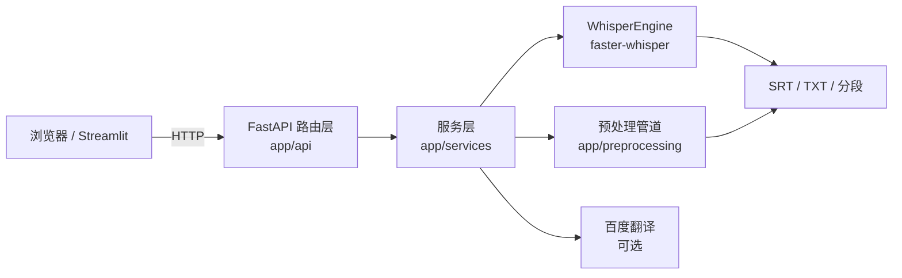

# FastAPI Whisper Transcriber

基于 **faster-whisper** 的音视频转写服务：上传音视频 → 得到 SRT 字幕 / 纯文本 / 带时间戳分段，并可选择翻译
成目标语言；在此基础上集成了音频预处理流水线（降噪、VAD、语音增强），可以对比"原始音频"与"预处理后音频"
的转写差异。

> 《Internet应用开发》（23306046）作业2 —— **方向 2：使用 Python 开发应用（Flask/FastAPI 服务）**
>
> 服务端使用 FastAPI，前端使用 Streamlit，模型推理使用 faster-whisper（CTranslate2 后端）。
> AI 工具使用情况见 [AI_USAGE.md](AI_USAGE.md)。

---

## 功能

| 模块 | 能力 | 接口 |
| --- | --- | --- |
| 单文件转写 | 上传音视频，输出 SRT / TXT / 分段，支持语言自动检测 | `POST /transcribe/file` |
| 批量转写 | 扫描目录批量处理，单个文件失败不影响整批 | `POST /transcribe/batch` |
| 字幕翻译 | 接入百度翻译，可输出纯译文或"原文+译文"双语字幕 | `target_lang` / `bilingual` |
| 音频预处理 | 5 套场景预设：降噪 + VAD + DRC/EQ/AGC/去齿音/去混响 | `POST /preprocess/audio` |
| 预处理对比 | 同一音频处理前后各转写一次，并排对比 | `POST /preprocess-and-transcribe` |
| 模型管理 | 运行期切换 tiny ~ large-v3，自动选择 GPU/CPU | `POST /model/load` |
| 健康检查 | 供前端与容器探活，模型未就绪时返回 `degraded` | `GET /health` |

预处理预设：

| 预设 | VAD | 降噪 | 增强 | 适用场景 |
| --- | --- | --- | --- | --- |
| `mobile` | WebRTC | 谱减法 | DRC + EQ + AGC | 手机端、边缘设备 |
| `desktop_high_quality` | 谱熵 | 谱门限 | DRC + EQ + AGC + 去齿音 | 桌面离线、追求质量 |
| `noisy_environment` | 谱熵 | 多频带 | DRC + EQ + AGC | 工厂、户外、人群 |
| `meeting_room` | 谱熵 | 维纳滤波 | DRC + EQ + AGC + 去齿音 + 去混响 | 会议室、多人发言 |
| `lightweight` | 关闭 | 卡尔曼 | 仅 AGC | 最低延迟、嵌入式 |

## 架构



分层职责：

- **路由层 `app/api`**：参数校验（Pydantic）、HTTP 语义（413/415/404/503）、依赖注入。
- **服务层 `app/services`**：模型推理（`asr.py`）、字幕渲染（`subtitle.py` / `render.py`）、翻译（`translate.py`）、
  文件处理（`media.py`）、预处理装配（`preprocess.py`）。
- **预处理子包 `app/preprocessing`**：5 种降噪、4 种 VAD、5 类增强算法与统一管道，只依赖 numpy/scipy，
  librosa 与 matplotlib 按需延迟导入。

## 快速开始

### 1. 准备环境

需要 Python 3.10+；视频文件还需要系统安装 [ffmpeg](https://ffmpeg.org/download.html)（音频文件可不用）。

```bash
git clone https://github.com/ypj06/fastapi-whisper-transcriber.git
cd fastapi-whisper-transcriber

python -m venv .venv
# Windows
.venv\Scripts\activate
# macOS / Linux
source .venv/bin/activate

pip install -r requirements.txt
```

国内网络建议加镜像：

```bash
pip install -r requirements.txt -i https://pypi.tuna.tsinghua.edu.cn/simple
# 模型下载慢时
export HF_ENDPOINT=https://hf-mirror.com   # Windows: set HF_ENDPOINT=https://hf-mirror.com
```

### 2. 启动后端

```bash
uvicorn app.main:app --port 8000
# 或
python -m app.main
```

首次启动会下载 `base` 模型（约 300 MB）到 `models/` 目录，之后直接读缓存。
接口文档：<http://127.0.0.1:8000/docs>

### 3. 启动前端

```bash
streamlit run frontend/app.py
```

打开 <http://localhost:8501>，侧边栏可修改后端地址、切换模型。

### 4. 试用

```bash
# 单文件
curl -X POST http://127.0.0.1:8000/transcribe/file \
  -F "file=@samples/english_video.mp4" \
  -G --data-urlencode "language=en" --data-urlencode "output_format=both"

# 命令行批量
python scripts/batch_transcribe.py --dir ./samples --lang en
```

仓库 `samples/` 内附一段英文示例视频与中英文 SRT 结果，可直接验证。

## 配置

复制 `.env.example` 为 `.env` 后修改；未配置的项使用默认值。

| 变量 | 默认值 | 说明 |
| --- | --- | --- |
| `WHISPER_MODEL_DIR` | `./models` | 模型缓存目录 |
| `WHISPER_MODEL_CHOICE` | `2` | 启动时加载的模型编号（1=tiny … 7=large-v3） |
| `WHISPER_LOCAL_PATH` | 空 | 指定已有的本地模型目录，优先于在线下载 |
| `WHISPER_DEVICE` | 自动 | `cuda` / `cpu`，留空则自动检测 |
| `WHISPER_COMPUTE_TYPE` | 自动 | 有 GPU 用 `float16`，否则 `int8` |
| `BAIDU_APP_ID` / `BAIDU_APP_KEY` | 空 | 百度翻译密钥；为空时翻译接口原样返回原文 |
| `MAX_UPLOAD_MB` | `500` | 单文件上传上限 |
| `CORS_ORIGINS` | `*` | 允许的跨域来源，逗号分隔 |
| `PORT` / `HOST` | `8000` / `127.0.0.1` | `python -m app.main` 时生效 |

## 项目结构

```
.
├── app/
│   ├── main.py                 # 应用工厂、lifespan、CORS
│   ├── config.py               # 环境变量与常量
│   ├── schemas.py              # Pydantic 出入参模型
│   ├── deps.py                 # 单例依赖（模型 / 翻译器）
│   ├── api/
│   │   ├── system.py           # / 、/health
│   │   ├── model.py            # /model/load、/model/info
│   │   ├── transcribe.py       # /transcribe/file、/transcribe/batch
│   │   └── preprocess.py       # /preprocess/*、/preprocess-and-transcribe
│   ├── services/
│   │   ├── asr.py              # WhisperEngine：加载与转写
│   │   ├── subtitle.py         # SRT / TXT 生成（纯函数）
│   │   ├── render.py           # 转写结果 → 输出产物
│   │   ├── translate.py        # 百度翻译（批量 + 缓存）
│   │   ├── media.py            # 上传落盘、目录扫描、临时文件
│   │   └── preprocess.py       # 预设 → 管道
│   └── preprocessing/          # 降噪 / VAD / 增强 / 管道 / 音频工具
├── frontend/app.py             # Streamlit 界面（4 个标签页）
├── scripts/batch_transcribe.py # 命令行批量客户端
├── tests/                      # pytest（字幕、文件、预处理、接口）
├── samples/                    # 示例视频与字幕
├── docs/                       # 接口与架构补充说明
├── requirements.txt
├── requirements-dev.txt
└── .env.example
```

## 测试

```bash
pip install -r requirements-dev.txt
pytest
```

测试覆盖：

- `test_subtitle.py`：时间戳格式化、SRT 生成、空片段跳过、双语字幕、翻译回调。
- `test_media.py`：目录扫描（大小写扩展名）、上传落盘、超限与非法类型、临时文件清理。
- `test_preprocess.py`：预设装配、参数覆盖与裁剪、不污染全局预设、管道输出形状。
- `test_api.py`：用 `FakeEngine` 替换推理后端，覆盖全部接口的正常与异常路径。

接口测试不需要下载模型，可直接在 CI 中运行。

## 实现说明

几个值得说明的设计取舍：

1. **转写只跑一次**。原实现为生成 SRT、TXT、分段各调用一次 `transcribe`，3 倍耗时；现在一次转写得到
   `segments`，SRT/TXT 从同一份结果派生（`app/services/render.py`）。
2. **上传落盘分块校验**。按 1 MB 分块写入临时文件，超过 `MAX_UPLOAD_MB` 立刻中止，不会先把整个文件读进内存；
   同时用 `tempfile` 命名避免原实现 `temp_{filename}` 带来的路径穿越风险。
3. **依赖分层**。`faster-whisper`、`torch`、`librosa`、`matplotlib` 全部延迟导入，因此没有 GPU 或没装推理依赖时
   服务仍可启动（`/health` 返回 `degraded`），接口测试也能脱离模型运行。
4. **重采样与 STFT 自行实现**。预处理只为 16 kHz 服务，重采样用 `scipy.signal.resample_poly`，
   短时傅里叶变换用 `numpy` 实现（`app/preprocessing/stft.py`，周期 Hann 窗 + 重叠相加归一化），
   从而彻底去掉对 librosa 的硬依赖。
5. **批量任务隔离**。单个文件抛异常只记录到该文件的 `results` 项，不影响同目录其它文件。
6. **翻译批量提交**。百度接口支持多行文本，按 20 行一批提交并缓存结果；返回行数不匹配时自动退回逐条翻译。


## License

MIT
