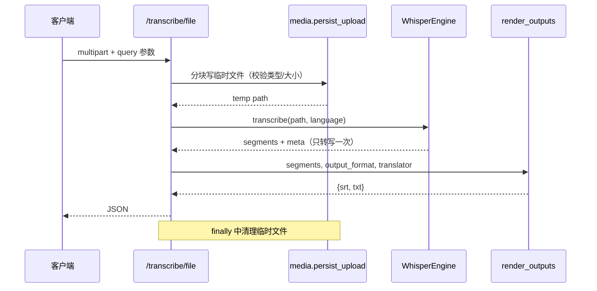
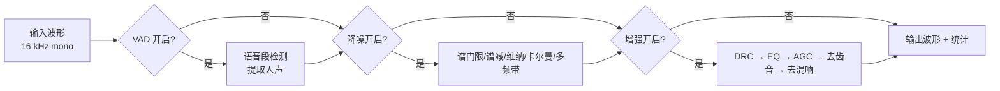

# 架构与实现说明

## 分层

```
HTTP 请求
   │
   ├── app/main.py           应用工厂：CORS、lifespan 预加载模型、挂载路由
   │
   ├── app/api/*.py          路由层：参数校验、状态码、依赖注入
   │        │
   │        └── app/deps.py  单例依赖：WhisperEngine、BaiduTranslator
   │
   ├── app/services/*.py     服务层：推理、渲染、翻译、文件、预处理装配
   │        │
   │        └── app/preprocessing/   算法层：降噪 / VAD / 增强 / 管道
   │
   └── app/config.py         配置层：环境变量、模型映射、常量
```

依赖方向单向向下，算法层不知道 HTTP 的存在，因此可以脱离 FastAPI 单独调用：

```python
from app.preprocessing import AudioPreprocessingPipeline, load_audio

audio, sr = load_audio("noisy.wav")
clean, stats = AudioPreprocessingPipeline.from_preset("meeting_room").process(audio, sr)
```

## 一次转写请求的调用链



## 预处理管道

`AudioPreprocessingPipeline.process()` 按顺序执行三段，每段可独立关闭：



- VAD 4 种：`energy`、`spectral_entropy`（纯 numpy）、`webrtc`（需 `webrtcvad`）、`silero`（需 `torch`）。
- 降噪 5 种：`spectral_gating`、`spectral_subtraction`、`wiener`、`kalman`、`multi_band`。
- 增强 5 类：动态范围压缩、参数均衡、自动增益、去齿音、去混响。
- 统计 `ProcessingStats` 记录各阶段耗时、时长变化、输入输出 RMS，前端直接展示。

## 关键设计取舍

| 问题 | 处理方式 | 原因 |
| --- | --- | --- |
| 同一次请求转写多次 | 一次转写得到 `segments`，SRT/TXT 派生 | 原实现 3 次推理，长音频直接 3 倍耗时 |
| 上传文件读入内存 | 1 MB 分块落盘，超限立即中止 | 避免大文件打爆内存 |
| `temp_{filename}` 作为临时路径 | `tempfile.NamedTemporaryFile` | 防止上传文件名带 `../` 造成路径穿越 |
| 硬编码模型路径 | `WHISPER_LOCAL_PATH` 环境变量 | 原代码写死了作者本机目录，别人跑不通 |
| 重依赖（torch/librosa/matplotlib） | 函数内延迟导入 | 无 GPU 环境也能启动、能跑测试 |
| 降噪/去混响依赖 librosa 的 STFT | 用 numpy 自实现 `stft.py`（Hann 窗 + 重叠相加归一化） | 去掉 numba/llvmlite 等重量级依赖，安装体积与耗时显著下降 |
| 批量任务一个失败全崩 | 逐个 try/except，结果写进 `results` | 批处理最重要的是"部分成功" |
| 翻译一条一请求 | 20 行一批 + 本地缓存 + 行数校验 | 几百条字幕的翻译请求数下降一个数量级 |
| 预设被就地修改 | `dataclasses.replace` 派生副本 | 原实现 `preprocess_for_asr` 会污染全局 `PRESETS` |

## 扩展点

- **换翻译服务**：实现 `translate_lines()` 与 `translate()` 两个方法即可，`render.py` 只依赖这个接口。
- **加输出格式（VTT/JSON）**：在 `app/services/subtitle.py` 增加构建函数，`render_outputs` 里加一个分支。
- **换推理后端**（如 whisper.cpp）：实现 `WhisperEngine.transcribe()` 的返回契约（`segments` + `meta`）即可。
- **异步化**：把 `/transcribe/batch` 改为投递任务队列，返回 `task_id`，另开查询接口。
